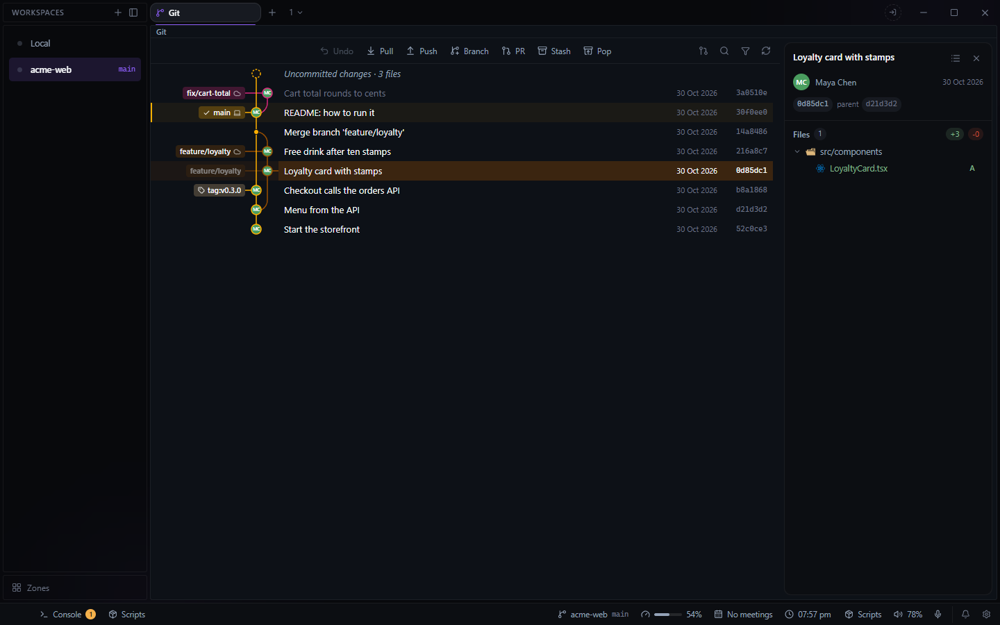

# Git for Deck

A commit graph for each workspace, with staging, committing, merge conflicts and pull requests, in
a pane. Open it from the **+** beside your tabs and choose **Git**.

- **Graph** of every branch, filterable to chosen ones, with search (Ctrl+F, or / while the list
  has focus), n and Shift+N between matches, h to jump to HEAD, Enter to show a commit.
- **Uncommitted changes**: stage, unstage and discard by file or folder, or one change at a time
  from its diff. Commit, amend, Commit & Push, Commit & Sync (pull with rebase, then push), and a
  commit message written by the AI command set in Deck's settings.
- **Merge conflicts**: conflicted files are listed under **Merge Changes**. One opens whole in a
  code editor with **Accept Current**, **Accept Incoming** and **Accept Both** over each block, or
  edit it by hand; it is saved as you go. **Side by side** shows both sides' full files above it,
  **Take all current** or **Take all incoming** settles the whole file, and **Mark as Resolved**
  stages it once no block is left. A banner over the graph offers **Continue** or **Abandon** for
  the merge, rebase or cherry-pick, and turns green when nothing is left to resolve.
- **Branches, tags, commits and stashes** from their right-click menus: check out, create, rename,
  push, delete, merge (merge commit, fast-forward or squash), rebase, reset, cherry-pick, revert,
  stash with or without untracked files, apply, pop, drop. Drag one branch onto another to merge
  or rebase it.
- **Undo** (Ctrl+Z) takes back the last checkout, merge, rebase, reset, commit or stash made here.
- **File history**: one file's commits, following renames.
- **Diffs** for every change, side by side or inline, images included.
- **Pull requests** on GitHub (`gh`) and GitLab (`glab`): list, review the files and commits,
  comment on a line, reply, resolve, merge, close, check out, and create one from a branch.
- The graph refreshes while it is on screen, so a commit made in a terminal or by an agent shows
  up.

A folder with several repositories gets a tab for each (drag to reorder, close, bring back from
the **+**), or a dropdown: **Repositories in one folder** in the plugin's settings. The graph's
keys can be changed in Settings > Keybindings. Clicking the commit hash in the Editor's status bar
opens this tab on that commit, and "Open File" opens a file in Deck's Editor.

Everything it shows is read from your repositories. It keeps only its setting and the repository
tabs' order in Deck's config on this machine: `settings.json`, `repo-order.json` and
`repo-hidden.json`.
